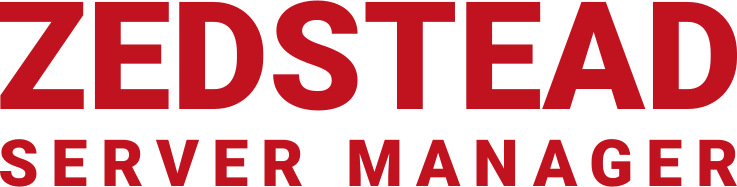
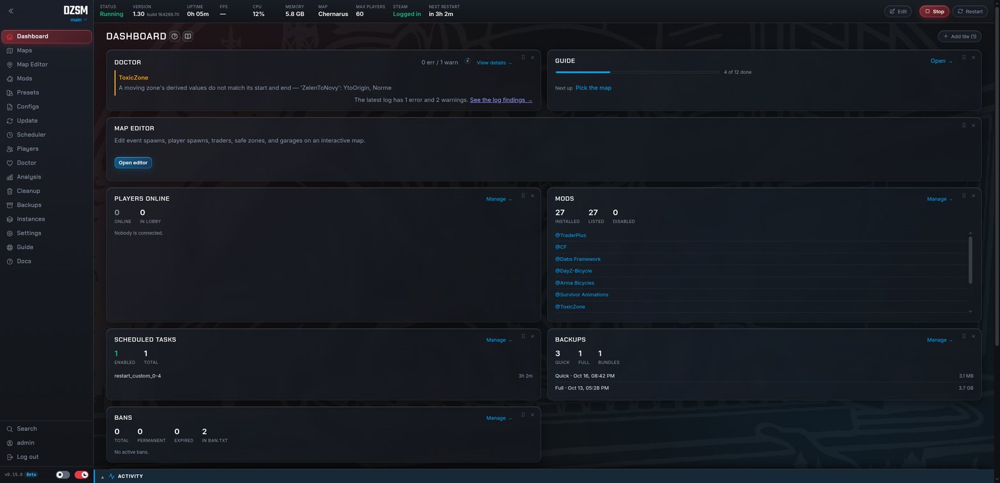
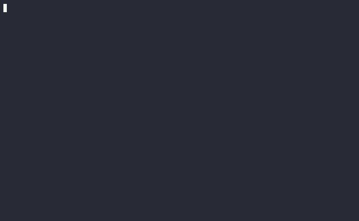

<p align="center">
  <a href="https://zedstead.com"></a>
</p>

# Zedstead - A DayZ Server Management **Web UI + CLI** for Windows & Linux

Run `zsm` and manage your server from the browser - or script the whole thing
from the command line. Built with Python, [Click](https://click.palletsprojects.com/),
[FastAPI](https://fastapi.tiangolo.com/) and [React](https://react.dev/).

**Zedstead is in beta while its version is 0.x.** In the app, a _Beta_ badge marks each feature that is tested in a test setup only.

<a href="https://zedstead.com/docs/features/#dayz-updates-keep-your-mission-edits"></a>

[](https://zedstead.com/#features)

<a href="https://zedstead.com/#features"></a>



_`zsm run all` on a 25-mod server, sped up. The summary table shows the real times._

## Features

An all-in-one DayZ server management platform that simplifies server setup, updates, mod management, configuration, backups, diagnostics, and live administration through a single web interface with CLI support.

<a href="https://zedstead.com/docs/features/"></a>

<table>
  <tr>
    <td width="50%">
      <h3>🚀 Quick setup</h3>
      The short way to a first server. Pick a card, configure your server and press Apply.
    </td>
    <td width="50%">
      <h3>🖥️ My server</h3>
      Manage the settings admins change most, with direct links to detailed configuration pages.
    </td>
  </tr>
  <tr>
    <td>
      <h3>🧭 Guided first run</h3>
      A guided complement to Quick setup for a deeper introduction to the app.
    </td>
    <td>
      <h3>🛡️ DayZ updates keep your mission edits</h3>
      Intelligently merges mission changes, detects conflicts and preserves custom settings across updates.
    </td>
  </tr>
  <tr>
    <td>
      <h3>🔄 Server lifecycle</h3>
      Updates, mod handling, backups, crash recovery and multi-server support on Linux and Windows.
    </td>
    <td>
      <h3>🧩 Mods</h3>
      Install, update, reinstall and uninstall mods. Automatic or manual load order and issue detection.
    </td>
  </tr>
  <tr>
    <td>
      <h3>📦 Pre-configured mods</h3>
      Integrated tools for TraderPlus, DayZ Expansion, Dynamic AI, RadZone and ToxicZone.
    </td>
    <td>
      <h3>🗺️ Maps</h3>
      Official and community maps, with more being added.
    </td>
  </tr>
  <tr>
    <td>
      <h3>✏️ Map editor</h3>
      Collaborative browser-based editor for spawns, traders, safe zones, garages and mod locations.
    </td>
    <td>
      <h3>🎛️ Config Presets</h3>
      Save, share, preview and reapply server configurations and difficulty settings.
    </td>
  </tr>
  <tr>
    <td>
      <h3>📝 Config editors</h3>
      Nearly 80 graphical config editors, raw file editing and economy analysis.
    </td>
    <td>
      <h3>📜 Config history</h3>
      Track changes, compare versions, review differences and restore previous configurations.
    </td>
  </tr>
  <tr>
    <td>
      <h3>↩️ Undo and restore</h3>
      Multiple ways to roll back changes and recover configurations.
    </td>
    <td>
      <h3>💾 Backups</h3>
      Flexible backups of player data, vehicles, worlds, mods and entire servers, including offsite storage.
    </td>
  </tr>
  <tr>
    <td>
      <h3>🧹 Cleanup</h3>
      Maintenance tools for wiping servers, clearing logs, managing databases and repairing installations.
    </td>
    <td>
      <h3>🩺 Diagnostics</h3>
      Log analysis, server monitoring, configuration tracking and system diagnostics.
    </td>
  </tr>
  <tr>
    <td>
      <h3>📊 Analysis</h3>
      Economy scoring, TraderPlus price checks, log analysis, configuration history and performance metrics.
    </td>
    <td>
      <h3>📡 Live ops</h3>
      Persistent RCON, automated scheduling, player-aware restarts, remote administration and Discord notifications.
    </td>
  </tr>
  <tr>
    <td>
      <h3>👥 Players</h3>
      Live player list, RCON controls, session history, kill stats, bans, whitelist and chat log.
    </td>
    <td>
      <h3>⚡ Performance</h3>
      Historical FPS, memory, CPU and player-count metrics with configurable retention.
    </td>
  </tr>
  <tr>
    <td>
      <h3>🗃️ Bundle</h3>
      Export and transfer server configurations between machines using validated ZIP bundles.
    </td>
    <td>
      <h3>🔀 Mission XML merging</h3>
      Merge mod XML configurations while preserving custom edits and original backups.
    </td>
  </tr>
  <tr>
    <td colspan="2">
      <h3>🖧 Instances</h3>
      Run several servers on one machine, including DayZ Experimental, with independent configuration file locations.
    </td>
  </tr>
</table>

<!--
### 🚀 Quick setup

The short way to a first server. Pick a card, read what it does, and press Apply. Zedstead installs the server, adds the mods you chose, sets the difficulty, and can start the server.

### 🖥️ My server

The settings most admins change first, as plain questions. Press Save when you are done. Each question links to the page that holds every setting of its kind.

### 🧭 Guided first run

A complement to the Quick setup for a deeper dive into the app

### 🛡️ DayZ updates keep your mission edits

Protects custom mission files during DayZ updates by intelligently merging changes, preserving custom settings, detecting conflicts, and allowing easy rollback without losing configurations.

### 🔄 Server lifecycle

Updates, mod handling, backups, crash recovery, and multi-server support on both Linux and Windows.

### 🧩 Mods

Install, update, reinstall and uninstall mods, auto sets load order or set it manually, check for issues. Pre-configured mods (see below).

### 📦 Pre-configured mods

Provides integrated support for TraderPlus, DayZ Expansion, Dynamic AI, RadZone, and ToxicZone, automating dependencies, configuration, validation, editing, and map visualization through dedicated tools and editors.

And more is being added

### 🗺️ Maps

Official maps and some community maps, and more community maps being added!

> Missing a map? [Open an issue](https://github.com/robba86/zedstead/issues).

### ✏️ Map editor

Includes a collaborative browser-based map editor for managing spawns, traders, safe zones, garages, contaminated areas, and mod locations, with live updates, collision detection, loot visualization, and direct XML/JSON saving.

### 🎛️ Config Presets

Save, share, preview, and reapply server configuration presets, with built-in difficulty settings and quick adjustments for zombies, animals, loot, infection, and more.

### 📝 Config editors

Close to _80 config editors_ as _graphical forms_, with _raw file editing_ in the app too, plus an _economy analysis_

### 📜 Config history

Tracks and versions all configuration changes, allowing you to review differences, compare versions, restore previous files, and monitor changes across your entire server setup.

### ↩️ Undo and restore

Several ways to go back. Each one puts back something different, so pick the one that matches what went wrong.

> Want another mod pre-configured? [Open an issue](https://github.com/robba86/zedstead/issues).

### 💾 Backups

Offers flexible backups of player data, vehicles, worlds, mods, and entire servers, with restore options, automatic retention, browser downloads, and secure offsite storage via SFTP, S3, or Backblaze B2.

### 🧹 Cleanup

Provides server maintenance tools for wiping servers, clearing logs, managing mods and player databases, resetting missions and configurations, repairing downloads, and reinstalling the server or SteamCMD.

### 🩺 Diagnostics

Comprehensive diagnostics, log analysis, configuration change tracking, server status monitoring, and system information tools to detect issues across the server, SteamCMD, mods, missions, and network without modifying anything.

### 📊 Analysis

The Analysis page scores your economy, checks TraderPlus prices, and holds the log analyzer, changes, config history and performance metrics. See The web UI → Analysis. (web UI)

### 📡 Live ops

Provides background server management with persistent RCON connectivity, automated scheduling, player-aware updates and restarts, in-game warnings, remote administration, Discord notifications, and Steam-based server monitoring.

### 👥 Players

The Players page: live player list, kick and broadcast over RCON, session history, kill stats, bans, priority queue, whitelist, an RCon console and the chat log. See The web UI → Players. (web UI)

### ⚡ Performance

Tracks server performance metrics, including FPS, memory, CPU usage, and player count, storing historical data in SQLite with configurable retention, trend views, and manual cleanup.

### 🗃️ Bundle

Export and transfer complete server configurations between machines using ZIP bundles, with selective imports, validation, and protection of local settings, while warning that exported bundles contain sensitive credentials in plain text.

### 🔀 Mission XML merging

Automatically merges mod XML configurations into mission files, preserves original backups, manages enabled and disabled mods, tracks custom configurations, and supports separate manual XML files to protect user edits across updates.

### 🖧 Instances

Several servers on one machine, a DayZ Experimental server, where the config file lives -->

> Missing a map, want another mod pre-configured, or anything else? [Open an issue](https://github.com/robba86/zedstead/issues).

<a href="https://zedstead.com/docs/features/"></a>

## Install

> **Back up first.** Zedstead comes with no warranty ([licence](LICENSE)): if it breaks a server, the author is not liable. Take a backup before you change a server people play on, and keep a copy off that machine. If Zedstead broke something, [open an issue](https://github.com/robba86/zedstead/issues) with what you did, the output of `zsm doctor` and `zsm log-analyzer`. Never attach a bundle or `config.json`: they can contain sensitive information, such as passwords.

<a href="https://zedstead.com/docs/install/"></a>

Read the guide first: requirements, what the installer asks, the Windows runtimes the server needs, and Docker. The commands below are the short version.

### Linux

```sh
curl -fsSL https://raw.githubusercontent.com/robba86/zedstead/main/install.sh -o /tmp/zsm-install.sh && sh /tmp/zsm-install.sh
```

### Windows

Needs [Git for Windows](https://git-scm.com/download/win) first

```powershell
powershell -ExecutionPolicy ByPass -c "irm https://raw.githubusercontent.com/robba86/zedstead/main/install.ps1 | iex"
```

### Manual install

[download the repository](https://github.com/robba86/zedstead/archive/refs/heads/main.zip), extract it, and run `install.sh` (Linux) or `install.bat` (Windows) inside it.

### Deploy on a VPS

Check a rented VPS before you pay for it (installs nothing):

```sh
curl -fsSL https://raw.githubusercontent.com/robba86/zedstead/main/preflight.sh -o /tmp/zsm-preflight.sh && sh /tmp/zsm-preflight.sh
```

Then install as root with the machine preparation:

```sh
curl -fsSL https://raw.githubusercontent.com/robba86/zedstead/main/install.sh -o /tmp/zsm-install.sh && sh /tmp/zsm-install.sh --yes
```

The whole thing in order: https://zedstead.com/docs/deploy-on-a-vps/

### Docker

https://zedstead.com/docs/install/#docker

### Already running a DayZ server?

Check out this doc: [You already run a server](https://zedstead.com/docs/install/#you-already-run-a-server). Coming from Nitrado, GTX or GPORTAL: [Migrating from a host](https://zedstead.com/docs/migrating-from-a-host/). [`user-data.yaml`](user-data.yaml) sets up a VPS on first boot through cloud-init.

## First run

In your terminal, running `zsm` alone (with no subcommand) runs the setup wizard if this machine has no config yet, then starts the web UI - the same thing as `zsm web`. The wizard asks for your Steam login (Steam Guard may ask for a code from the Steam mobile app or from an email), and the first start of the app asks for its password.

> Zedstead does not store your Steam password. In the terminal, SteamCMD asks for it itself, so Zedstead never sees it. The app's Steam login hands it to SteamCMD in a file only your user can read, and removes the file as soon as SteamCMD is done. Zedstead keeps only the username. The login token is cached by SteamCMD, as with any SteamCMD install.

The CLI is fully flag-driven and built for scripting and cron; `zsm --help` lists every command.

## Documentation

The documentation lives on zedstead.com.

<a href="https://zedstead.com/docs/"></a>

## Uninstall

```sh
curl -fsSL https://raw.githubusercontent.com/robba86/zedstead/main/uninstall.sh -o /tmp/zsm-uninstall.sh && sh /tmp/zsm-uninstall.sh
```

On Windows, close Zedstead and run `uninstall.bat` or `uninstall.ps1`. The DayZ server, its mods and its service are left alone; your config dir goes only if you type `delete`. Details: [Install → Uninstall](https://zedstead.com/docs/install/#uninstall).

## How Zedstead is built

Built by robba86 (for now), with a little help from Claude Code, Anthropic’s AI coding assistant. Claude Code writes most of the Python, while robba86 guides development, tests everything on real DayZ servers — from bare metal and VMs to Docker and rented VPS setups — and makes the final call on what gets released.

The CLAUDE.md files in this repo contain the instructions Claude Code follows when working on Zedstead. They're also there for anyone who wants to jump in and contribute.

## Contributing

Proposals, improvements, bug reports, and collaborators all welcome - open an [issue](https://github.com/robba86/zedstead/issues) or a PR. Happy to pair up with anyone who wants to help make Zedstead more awesome. See [CONTRIBUTING.md](CONTRIBUTING.md); running from source is in [README-DEV.md](README-DEV.md).

## Roadmap

What is planned next, what comes later and what is not planned at all is in [ROADMAP.md](ROADMAP.md). There are no dates.

## Security

Report a vulnerability privately, never in a public issue: see [SECURITY.md](SECURITY.md).

## Licence

[PolyForm Noncommercial 1.0.0](LICENSE): free to download, use, change and share for any noncommercial purpose; commercial use is not allowed. Files by other people, such as the web UI's libraries and its fonts, keep their own terms: see [THIRD_PARTY_NOTICES.md](THIRD_PARTY_NOTICES.md).

Contributions need a signed [Contributor License Agreement](CLA.md); CLA Assistant asks for it on your first pull request.

> _This app is not affiliated or authorized by Bohemia Interactive. Bohemia Interactive, DAYZ and all associated logos and designs are trademarks or registered trademarks of BOHEMIA INTERACTIVE a.s._
